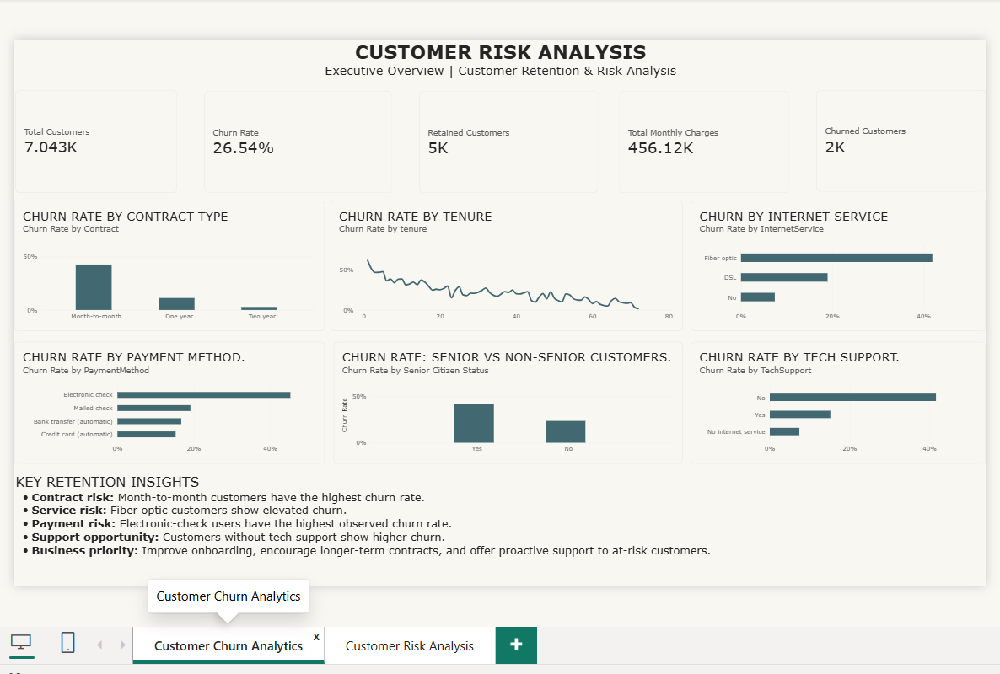
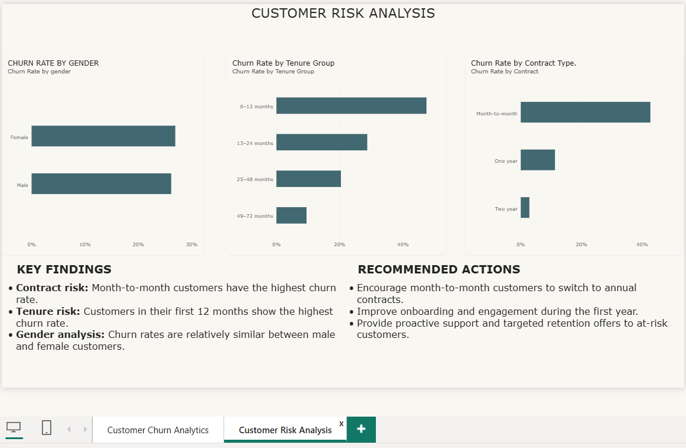

# Customer Retention & Churn Analysis

**Future Interns — Data Science & Analytics Internship | Task 2 (2026)**

## Project Overview
This project analyzes customer retention and churn patterns using the Telco Customer Churn dataset. The goal is to identify customer segments with higher churn risk and recommend data-driven strategies to improve retention.

## Objectives
- Analyze the overall customer churn rate.
- Compare churn across contract types, tenure groups, internet services, payment methods, gender, and support availability.
- Identify customer groups that may need targeted retention efforts.
- Present findings through an interactive Power BI dashboard.

## Tools Used
- **Power BI Desktop** — data modeling, DAX measures, visualizations, and dashboard development.
- **Power Query** — data cleaning and preparation.
- **CSV** — dataset format.

## Dataset
The project uses the Telco Customer Churn dataset, containing customer demographics, subscribed services, contract details, tenure, charges, and churn status.

Dataset source: [Kaggle — Telco Customer Churn](https://www.kaggle.com/datasets/blastchar/telco-customer-churn)

## Dashboard Pages

### Page 1 — Customer Churn Analytics
Provides an executive overview with customer KPIs and churn comparisons across contract type, tenure, internet service, payment method, senior citizen status, and technical support.

### Page 2 — Customer Risk Analysis
Compares churn rates by gender, tenure group, and contract type, with findings and recommended retention actions.

## Key Findings
- Month-to-month customers have the highest observed churn rate across contract types.
- Customers with shorter tenure show higher churn risk.
- Electronic-check users show elevated churn in the analyzed dataset.
- Customers without technical support show higher churn in the analyzed dataset.
- Gender differences appear smaller than contract and tenure differences.

## Recommendations
1. Encourage eligible month-to-month customers to consider longer-term contracts.
2. Improve onboarding and engagement during the first year.
3. Offer proactive technical support and targeted retention programs.
4. Monitor churn patterns regularly to evaluate retention initiatives.

## Project Files
- `Customer_Retention_Churn_Analysis.pbix` — Power BI report.
- `WA_Fn-UseC_-Telco-Customer-Churn.csv` — dataset.
- `customer-churn-overview.png` — Page 1 screenshot.
- `customer-risk-analysis.png` — Page 2 screenshot.

## Conclusion
This project demonstrates how customer churn data can be transformed into actionable insights through data preparation, analysis, and Power BI visualization.

**Project completed as part of the Future Interns Data Science & Analytics Internship.**
